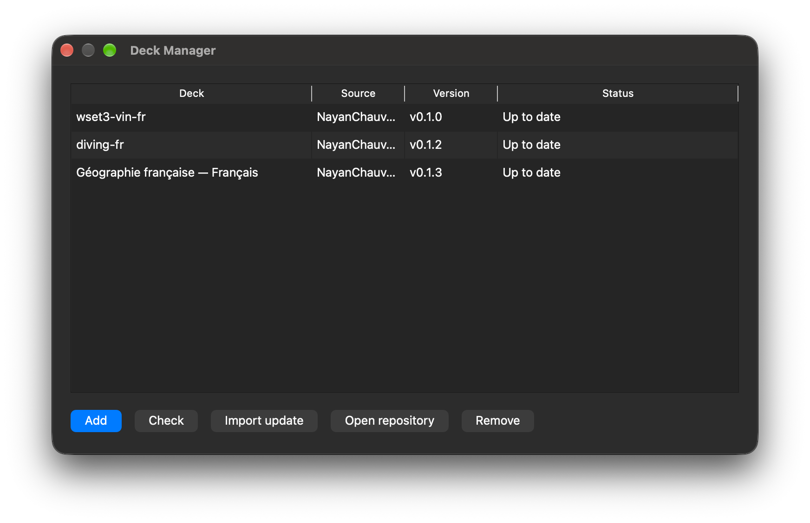

# Deck Manager

An add-on for Anki Desktop that installs `.apkg` decks published on GitHub and offers updates when their version numbers change.

Requires Anki **26.09** or later. Open **Tools → Deck Manager**. No account or token is needed: tracked repositories are public. The window follows Anki’s language: French or English, with English used for all other languages.



## Installation

Download the `.ankiaddon` file from the [latest release](https://github.com/NayanChauveau/anki-deck-manager/releases/latest), then double-click it. Alternatively, in Anki, choose **Tools → Add-ons → Install from file**. Restart Anki.

## Add a deck

Paste a URL in exactly this format:

```text
https://github.com/owner/repository/releases/download/v1.2.0/my-deck.apkg
```

The version number (`v1.2.0` or `1.2.0`) and filename are part of the URL. The filename must stay the same across releases.

Repository pages, “latest” links, and tags such as `latest-main` are rejected. Two files from the same repository, such as French and English editions, are tracked separately.

The display name is the asset’s label on GitHub, or its filename without `.apkg` if no label is set.

## Everyday use

At startup, if a new version is available, a window offers **Later** or **Import update**. Choosing **Later** postpones the update until the next startup. When several updates are available, select them using the checkboxes; they are imported one at a time.

The manager window shows each deck, its source, version, and status.

- **Check** checks for updates immediately.
- **Import update** downloads the file and opens Anki’s import dialog, the same one used by **File → Import**. Your import options remain yours to choose. The version is recorded only after you confirm the import.
- **Open repository** opens the GitHub repository page.
- **Remove** stops tracking the deck. The deck stays in Anki.

Automatic checks run at most once every 24 hours per repository, without blocking Anki. **Check** bypasses this interval. If you are offline, the repository is unavailable, GitHub’s rate limit is reached, or the file is missing, the table shows the corresponding status.

## What counts as an update

Deck Manager reads the repository’s latest stable release.

- The version number has changed: an update is offered.
- The version number is unchanged: no update is offered, even if the file has been replaced.
- `v1.2.0` and `1.2.0` are treated as different versions.
- Version numbers are not sorted. `v1.10` is not considered “greater” than `v1.9`: GitHub determines the latest stable release, and Deck Manager compares the two version strings.

Importing adds and updates cards. It does not delete cards that are missing from the new package.

## Publish a deck

1. Create one GitHub release per version, tagged `vX.Y.Z` (or `X.Y.Z`).
2. Keep the same `.apkg` filename across releases.
3. Share the URL `…/releases/download/vX.Y.Z/file.apkg`.
4. To change the content, publish a **new** version number. Do not replace the file in an existing release.

Repositories that only publish `latest-main` cannot be tracked.

## License

[GNU AGPL v3.0](https://www.gnu.org/licenses/agpl-3.0.html) or later.
